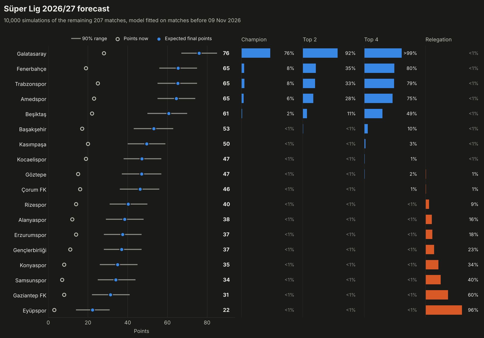
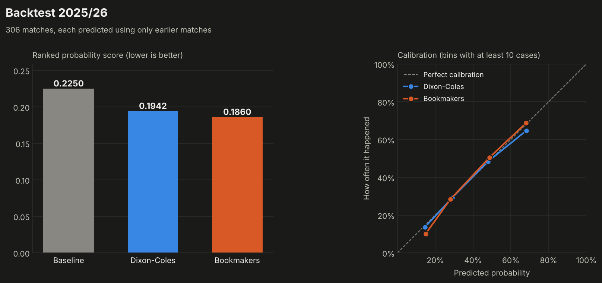

# Süper Lig Prediction Model

A command-line tool and a Streamlit app that rate every Süper Lig club with a
Dixon-Coles model, predict single matches, simulate the rest of the season and
check the model honestly against bookmakers.



## What it does

- Downloads every Süper Lig result since 2015/16 (3,799 matches so far), with bookmaker odds.
- Fits a Dixon-Coles model that gives each club an attack and a defence rating.
- Predicts any match: win/draw/loss chances, expected goals and the most likely scores.
- Simulates the rest of the season 10,000 times: title, top 2, top 4 and relegation
  chances, expected points and the chance of every final position.
- Travels back in time with `--as-of`: forecast a season from any past date and compare
  it with what really happened.
- Backtests itself over a full season against a naive baseline and against bookmakers.

## How the model works

Goals are modelled as Poisson counts. For a match between a home and an away club:

```
home goals ~ Poisson(λ),   λ = exp(intercept + home_adv + attack[home] + defence[away])
away goals ~ Poisson(μ),   μ = exp(intercept + attack[away] + defence[home])

P(score x-y) = τ(x, y) · Poisson(x; λ) · Poisson(y; μ)
```

`τ` is the Dixon-Coles correction for the four low scores, where independent
Poisson goals are slightly wrong (`ρ` is fitted, about -0.09 here, which makes
0-0 and 1-1 a little more likely):

```
τ(0,0) = 1 - λμρ     τ(0,1) = 1 + λρ     τ(1,0) = 1 + μρ     τ(1,1) = 1 - ρ     otherwise 1
```

The parameters are found by maximising the likelihood of all past matches, with two additions:

- **Time decay.** A match played `d` days ago has weight `exp(-0.0019 · d)`, so a match
  one year old counts about half as much as one played yesterday.
- **Ridge penalty.** `4 · (Σ attack² + Σ defence²)` is added to the loss. It pulls clubs
  with few matches, such as newly promoted ones, towards the league average.

The fitted home advantage is 0.24, which means the home side scores about 27% more goals
than it would away. The fit uses SciPy's L-BFGS-B with an analytic gradient and takes
about 0.04 seconds.

For the season forecast, every remaining fixture is sampled from its score matrix in each
simulation. Each simulated final table is ranked with the Süper Lig rule for clubs level
on points: head-to-head points, head-to-head goal difference, head-to-head goals, then
overall goal difference and overall goals.

## How good is it

Walk-forward backtest of 2025/26: before every match day the model is refitted using only
earlier matches, then it predicts that day's games. All three forecasters are scored on
the same 306 matches.

| Forecaster  | RPS    | Log loss | Brier  | Accuracy |
|-------------|--------|----------|--------|----------|
| Baseline    | 0.2250 | 1.0861   | 0.6578 | 42.2%    |
| Dixon-Coles | 0.1942 | 0.9940   | 0.5954 | 51.6%    |
| Bookmakers  | 0.1860 | 0.9695   | 0.5790 | 54.2%    |

The baseline is the league's home/draw/away frequencies from earlier seasons. Bookmaker
probabilities are `1/odds`, normalised to remove the margin. RPS (ranked probability
score) is the main metric; lower is better.

The model is clearly better than the baseline and worse than the bookmakers. It closes
about 80% of the gap between the two. The picture is the same in 2023/24 (0.1963 against
0.1870) and 2024/25 (0.1972 against 0.1827).



### Choosing the time decay and the ridge penalty

A grid search on 2024/25 alone picked a faster decay (0.005) and a ridge of 2. On the
untouched 2025/26 season that choice scored 0.1946, no better than the defaults, so a
single season is too noisy to tune on.

The ridge penalty was later raised from 0.5 to 4 for a different reason. With 0.5 the
model rated promoted clubs on very little evidence: after 11 matches of 2026/27 it made
Amedspor the second favourite for the title, far above what bookmakers implied. On the
early-season matches of promoted clubs in 2019/20 to 2025/26 (289 matches), a ridge of 4
improves the RPS from 0.2244 to 0.2164, and the average over all matches of those seven
seasons improves slightly, from 0.2055 to 0.2047. This choice was made looking at all
seven seasons, including 2025/26, so the table above is not a fully untouched test of it.
On 2025/26 alone the change is within noise (0.1937 with 0.5, 0.1942 with 4).

As a second check, the season forecast made with data up to 15 January 2026, exactly half
way through 2025/26, was off by 3.5 points per club on average. It had the eventual
champion as a 71% favourite.

## Data

- Results and odds: [football-data.co.uk](https://www.football-data.co.uk/turkeym.php),
  one CSV per season.
- Fallback for results only: [openfootball/football.json](https://github.com/openfootball/football.json).
  It was not needed for any season so far.

The processed table is committed as `data/matches.csv`. In 2022/23 two clubs withdrew
after the earthquake of 6 February 2023 and their remaining 29 matches were awarded 3-0.
These count for the league table but are left out of the model fit.

## Limitations

- The model only knows results. It knows nothing about injuries, transfers, coaching
  changes or line-ups, so a club's improvement only shows after the results do. Bookmakers
  have all of that information, which is why matching them would already be a strong result.
- Early in a season, promoted clubs are rated on very few matches. The ridge penalty
  limits this, but the model still rates a fast-starting promoted club higher than
  bookmakers do.
- The percentile ranges reflect the luck of the remaining matches, not the uncertainty in
  the ratings themselves, so they are somewhat too narrow.
- Point deductions are supported through `data/deductions.csv` (`season,team,points`), but
  no deductions are included, because I could not verify them from an official source.
- The tie-break rule follows press reports of the TFF regulations, not the official text.
- A forecast of 2022/23 made "as of" a date after the two clubs withdrew simulates their
  remaining matches as normal games.

## How to run it

Python 3.12 or newer.

```
pip install -r requirements.txt

python predict.py fetch                         # download results, rebuild data/matches.csv
python predict.py ratings                       # club ratings
python predict.py match galatasaray fener       # one match (part of a name is enough)
python predict.py table --season 2025           # league table with tie-breaks
python predict.py simulate                      # forecast the current season
python predict.py simulate --season 2025 --as-of 2026-01-15    # forecast from a past date
python predict.py backtest --season 2025        # walk-forward backtest
python predict.py backtest --season 2025 --tune 2024           # tune on an earlier season first

streamlit run app.py                            # the app
python -m pytest                                # the tests
```

Charts and CSV files are written to `output/`.

## Project structure

```
predict.py                command line (argparse with sub-commands)
app.py                    Streamlit app
predictor/data.py         download, clean, club names, remaining fixtures
predictor/model.py        Dixon-Coles model
predictor/table.py        league table and Süper Lig tie-break rules
predictor/simulate.py     Monte Carlo season simulation
predictor/evaluate.py     walk-forward backtest, scoring rules, calibration
predictor/charts.py       matplotlib charts for output/
tests/                    pytest tests
data/matches.csv          processed results
output/                   charts and CSVs
```

## Reference

Dixon, M. J. and Coles, S. G. (1997). Modelling association football scores and
inefficiencies in the football betting market. *Applied Statistics*, 46(2), 265-280.

## Licence

MIT, see [LICENSE](LICENSE).
